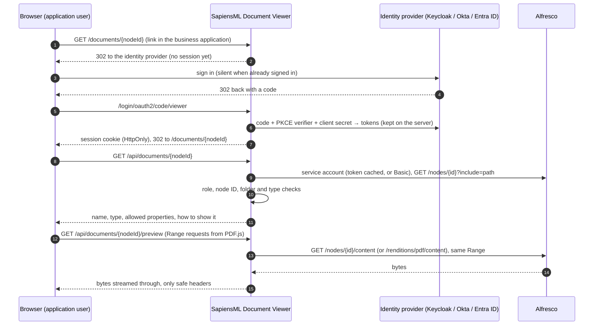

# SapiensML Document Viewer

[](https://github.com/sapiensml/sapiensml-document-viewer/actions/workflows/ci.yml)
[](LICENSE)

A secure, browser-based viewer for documents stored in Alfresco, by [SapiensML](https://sapiensml.com). Open source under the Apache License 2.0.

Business applications (FINEOS, Guidewire, Salesforce, a customer portal, a case-management system) often store their documents in Alfresco and keep only the node ID. Their users should see the document they were sent to, and nothing else: no browsing in Share or Digital Workspace, and no path from the browser to the repository. The SapiensML Document Viewer does exactly that:

- The application links to `https://<viewer>/documents/<alfresco node id>`.
- The user signs in with the organisation's identity provider (Keycloak, Okta, Microsoft Entra ID, or any OpenID Connect provider); usually silently, because they are already signed in.
- The viewer reads the document from Alfresco with **one service account** and shows it in the browser. PDF, images and text open as they are; Word, Excel, TIFF, e-mail and other formats open as Alfresco's PDF rendition.

The browser never talks to Alfresco and never holds a token. An administrator enters the Alfresco connection once on the viewer's admin page (`/admin`); it is tested before it is saved and kept on the server with the secret encrypted.

Works with Alfresco Content Services (Community or Enterprise, 7.x and later) and Alfresco PaaS, with Basic authentication or OAuth2 client credentials (Alfresco Identity Service). Spring Boot 4.1 (Java 21) and React 19 (PDF.js 6), shipped as one jar. No containers needed; installers for [Linux](DEPLOY.md) (`sudo ./install.sh all ...`) and [Windows Server](DEPLOY-WINDOWS.md) (`.\install.ps1 All ...`) set up a fresh server completely, Keycloak and PostgreSQL included.

## How it works



## Design decisions

| Concern | Decision | Why |
|---|---|---|
| Sign-in | Backend for frontend: OpenID Connect authorization code flow with PKCE, confidential client, tokens only on the server, `HttpOnly` `SameSite=Lax` session cookie | No token in the browser to steal. Standard OIDC, so identity providers are interchangeable through configuration |
| Deep links | The `/documents/{id}` request is saved and returned to after sign-in | A link opens the document, not a home page |
| Alfresco access | One service account: OAuth2 client credentials (token cached until a minute before expiry, refreshed once on a 401) or Basic | Users need no Alfresco accounts |
| Alfresco connection setup | Entered once on the admin page by a user with the admin role (`VIEWER_ADMIN`, separate from viewing). Saved only after a live test (token, repository, each allowed folder) passes; used from the next request on, without a restart. Kept in `alfresco-settings.json` (owner-only file) with the secret AES-256-GCM encrypted by `VIEWER_SETTINGS_KEY`. Secrets are never sent back to the browser, and a stored secret is reused only for the same token endpoint and client ID (or address and user), so a changed address never receives it. Every save and refused save is audited | No secrets to hand-edit into files; a wrong secret is caught before it breaks viewing |
| Who may view | Role from a configurable claim (`roles` in Keycloak, `groups` in Okta or Entra ID) mapped to the viewer's own `DOCUMENT_VIEWER` role | Provider-specific names stay in configuration |
| Which documents | Node ID must be a UUID (or `workspace://SpacesStore/<uuid>`); node must be a file, below an allowed folder, of an allowed type | A node ID in a link is easy to change, and the service account can read more than users should see. Folders are matched by node ID, because a service account that cannot see the folders above its own gets a shortened path |
| No existence oracle | Missing, unreadable, out of scope and folder all answer the same 404 | The viewer cannot be used to probe which documents exist |
| Streaming | Content is copied through in 64 KB chunks, never buffered; one `Range` header is passed through, so PDF.js loads only the parts it needs. When the browser cancels, the Alfresco connection is dropped instead of drained | Large files cost little memory, and abandoned downloads cost nothing |
| Headers | Only content type (from an allow-list, not from Alfresco), length, range and disposition are passed on. `Cache-Control: private, no-store`, `Content-Security-Policy: sandbox` on content, `nosniff` | Alfresco's cookies, server name and errors never reach the browser; sensitive documents are not cached |
| File types | PDF, PNG/JPEG/GIF/WebP/BMP and plain text are shown as they are. Everything else (Word, Excel, TIFF, e-mail, HTML, SVG) is shown as Alfresco's PDF rendition, requested on first view (the browser waits and retries) | One viewer for all types; nothing active (HTML, SVG) is ever rendered |
| Viewer | React viewer on PDF.js: lazy page rendering, text layer (select and Ctrl+F work), zoom, rotate, page jump, print (when allowed), download (off by default). Form fields, stamps and signatures are drawn; nothing in the PDF is interactive or runs scripts | Full control over what users can do |
| Page security | CSP `default-src 'none'`, scripts only from the viewer (`'wasm-unsafe-eval'` for PDF.js image decoders), `frame-ancestors 'none'` unless configured, `Referrer-Policy: no-referrer`, CSRF token for sign-out | |
| Audit | Every view, content opening, download, refusal and settings change: user, subject, node ID, outcome, client IP, correlation ID. In production as JSON in its own rolling file | Who saw which document, without logging names or contents |
| Operations | Health and info on a separate loopback-only port (always plain HTTP); readiness does not depend on Alfresco; JSON logs; graceful shutdown; correlation IDs in every error | |

## URLs

| URL | Who | What |
|---|---|---|
| `/documents/{nodeId}` | Links from business applications | The viewer page (signs in first) |
| `/view?nodeId={id or nodeRef}` | Link templates that can only add a parameter | Redirects to `/documents/{nodeId}` |
| `/admin` | Administrators | The Alfresco connection (address, service account, allowed folders) |
| `/api/session` | The page | Signed-in user and what they may do |
| `/api/documents/{nodeId}` | The page | Document details (`viewer`: `PDF`, `IMAGE`, `TEXT` or `NONE`) |
| `/api/documents/{nodeId}/preview` | The page | Content to show (original or PDF rendition), Range supported. `202` + `Retry-After` while a rendition is being made |
| `/api/documents/{nodeId}/download` | The page | The original file, when `VIEWER_ALLOW_DOWNLOAD=true` |
| `/api/admin/alfresco` (GET, PUT), `/api/admin/alfresco/test` (POST) | The admin page | The connection without secrets; test; save (tests first: 200 saved, 422 test failed, 400 field errors) |
| `/logout` (POST) | The page | Signs out here and at the identity provider |
| `:8081/actuator/health`, `/health/readiness`, `/info` | Installers, monitoring | Loopback only |

## Configuration

Everything comes from environment variables: on Linux in `/etc/sapiensml-document-viewer/viewer.env` ([template](deploy/linux/viewer.env.example)), on Windows in `C:\ProgramData\SapiensML\viewer\viewer.properties` ([template](deploy/windows/viewer.properties.example)). The main ones:

| Variable | Example | Meaning |
|---|---|---|
| `VIEWER_OIDC_ISSUER_URI` | `https://sso.sapiensml.com/realms/sapiensml` | Identity provider (read at start-up) |
| `VIEWER_OIDC_CLIENT_ID`, `VIEWER_OIDC_CLIENT_SECRET` | `sapiensml-document-viewer` | The viewer's client at the identity provider |
| `VIEWER_ROLES_CLAIM`, `VIEWER_ROLES` | `roles`, `DOCUMENT_VIEWER` | Claim with roles or groups, and the values that may view |
| `VIEWER_ADMIN_ROLES` | `VIEWER_ADMIN` | Claim values that may use the admin page |
| `VIEWER_OIDC_IDP_HINT` | `okta` | Keycloak only: go straight to a brokered provider |
| `VIEWER_SETTINGS_KEY` | base64 of 32 random bytes | Encrypts the secrets the admin page stores (the installers generate it) |
| `VIEWER_APP_NAME` | `Claims Document Viewer` | The name in the page header (default `SapiensML Document Viewer`) |
| `VIEWER_SOURCE_APPLICATION` | `FINEOS` | The application whose links open documents, named in the page's hints |
| `VIEWER_DISPLAY_PROPERTIES` | `cm:title=Title,ins:caseNumber=Case` | Repository properties shown next to a document, in order. Nothing else reaches the browser (default: title, description, author) |
| `VIEWER_ALLOWED_NODE_TYPES` | `cm:content,ins:document` | Optional type allow-list |
| `VIEWER_ALLOW_DOWNLOAD`, `VIEWER_ALLOW_PRINT` | `false`, `true` | Viewer features |
| `VIEWER_FRAME_ANCESTORS` | `https://app.example.com` | Allow framing by the business application (default: no framing) |
| `VIEWER_ALFRESCO_*`, `VIEWER_ALLOWED_FOLDER_IDS` | | Optional: an Alfresco connection given by the environment, used until one is saved on the admin page |

## Identity providers

The viewer speaks plain OpenID Connect, so changing provider is configuration only.

- **Keycloak.** The installers create a realm `sapiensml` with the client and both roles. To use an existing realm, create a confidential client with standard flow and PKCE (S256), redirect URI `https://<viewer>/login/oauth2/code/viewer`, post-logout redirect URI `https://<viewer>/signed-out`, and a mapper that puts realm roles into a `roles` claim of the ID token.
- **Keycloak brokering Okta or Entra ID.** Add the provider under *Identity providers*, map its group to the `DOCUMENT_VIEWER` role, and set `VIEWER_OIDC_IDP_HINT=<alias>` so users skip Keycloak's own page.
- **Okta directly.** An OIDC *Web* app (authorization code, PKCE, client secret) with the redirect URIs above and a `groups` claim in the ID token; then `VIEWER_OIDC_ISSUER_URI=https://<org>.okta.com/oauth2/<server id>`, `VIEWER_ROLES_CLAIM=groups`, `VIEWER_ROLES=<group>`, `VIEWER_ADMIN_ROLES=<admin group>`.
- **Microsoft Entra ID directly.** An app registration (web, client secret) with the redirect URIs above and app roles assigned to users; then `VIEWER_OIDC_ISSUER_URI=https://login.microsoftonline.com/<tenant id>/v2.0` and `VIEWER_ROLES_CLAIM=roles`.

## Run locally (no Docker)

Needs JDK 21, Maven 3.9 and Node 20.

```bash
./deploy/local/keycloak.sh start     # first time: downloads Keycloak 26.8.2, imports realm sapiensml, port 18210
./deploy/local/run-viewer.sh --build # http://localhost:18200
```

The first time, open http://localhost:18200/admin, sign in as `vieweradmin` / `vieweradmin`, and enter the Alfresco connection, for example the SapiensML test repository:

| Field | Value |
|---|---|
| Repository address | `https://alfresco.sapiensml.com` |
| Sign-in to Alfresco | User name and password (a repository user that can read the document folders) |
| Allowed folders | The node IDs of the folders whose documents may open |

The connection is kept in `deploy/local/.work/settings`. Then open `http://localhost:18200/documents/<node id>` as `viewer` / `viewer` (can view), `vieweradmin` / `vieweradmin` (can view and administer) or `noaccess` / `noaccess` (neither). Keycloak's admin console is http://localhost:18210/admin (`admin` / `admin`). `./deploy/local/keycloak.sh stop | status | logs | reset`.

For front-end work: `cd frontend && npm run dev` serves the UI with hot reload on http://localhost:5173 and passes API calls to the viewer on 18200. Sign in once at http://localhost:5173/oauth2/authorization/viewer.

## Build and test

```bash
mvn verify                                   # npm ci, UI tests (Vitest), UI build, Java tests (WireMock), 80% line coverage gate
mvn verify -Dviewer.skipUi=true              # reuse frontend/dist
./deploy/package.sh                          # releases: target/sapiensml-document-viewer-<version>.tar.gz (Linux) and -windows.zip
```

The Java tests run the whole application against WireMock playing the identity provider (OpenID discovery), the token endpoint and the Alfresco repository.

## Roadmap

- **Entitlement checks in the business application.** Today any user with the viewer role can open any document in the allowed folders. A `DocumentAccessPolicy` bean (see `ScopeAccessPolicy`) can ask the business application whether the user may see the document's case or customer (for example a FINEOS entitlement call using a case-number property).
- **Watermarking** with the user's name and the time, on screen and on print.
- **Several servers.** Sessions are held in memory, so behind a load balancer with more than one viewer use sticky sessions, or add Spring Session (JDBC or Redis). The admin page saves the connection on the server it runs on: with several servers, use the same `VIEWER_ALFRESCO_*` settings, or a shared `VIEWER_SETTINGS_DIR` and the same `VIEWER_SETTINGS_KEY`.
- **Framing.** Opening the link in a new tab is the tested path. Showing the viewer inside another application's frame needs `VIEWER_FRAME_ANCESTORS` and works only if the browser sends the viewer's cookie in that frame (same site, or third-party cookies allowed).

## Contributing and security

Issues and pull requests are welcome; see [CONTRIBUTING.md](CONTRIBUTING.md) (commits are signed off under the DCO) and the [Code of Conduct](CODE_OF_CONDUCT.md). Report vulnerabilities privately as described in [SECURITY.md](SECURITY.md), never in a public issue. Changes are listed in [CHANGELOG.md](CHANGELOG.md).

The viewer does not change the terms of your Alfresco subscription: check with Hyland how users who view documents through a service account are counted under your agreement.

## Support

Community support is best effort, through GitHub issues. [SapiensML](https://sapiensml.com) offers installation, integration with your business application and identity provider, and support plans with guaranteed response times. Contact us at [www.sapiensml.com/contact](https://www.sapiensml.com/contact).

## About

Built and supported by [SapiensML](https://sapiensml.com): enterprise content management consulting and customization across the Hyland, OpenText and IBM ecosystems, AI business automation and custom software. Implementation partner: Plus Your Softech.

## Licence

Copyright © 2026 SapiensML Technologies. Licensed under the [Apache License, Version 2.0](LICENSE); see also [NOTICE](NOTICE). "SapiensML" and the SapiensML logo are trademarks of SapiensML Technologies and are not covered by the licence.
